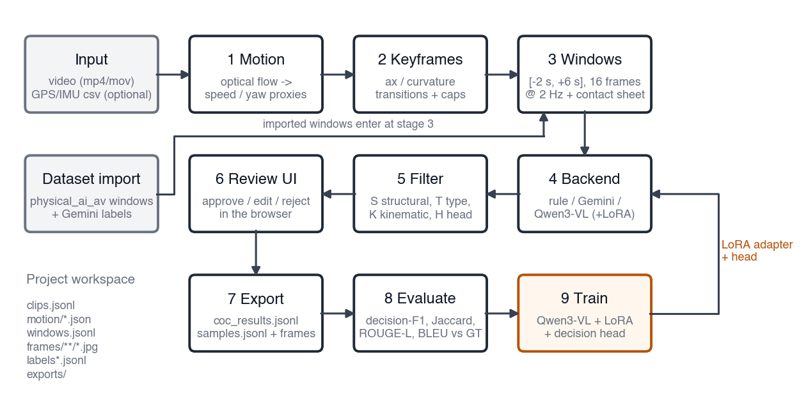
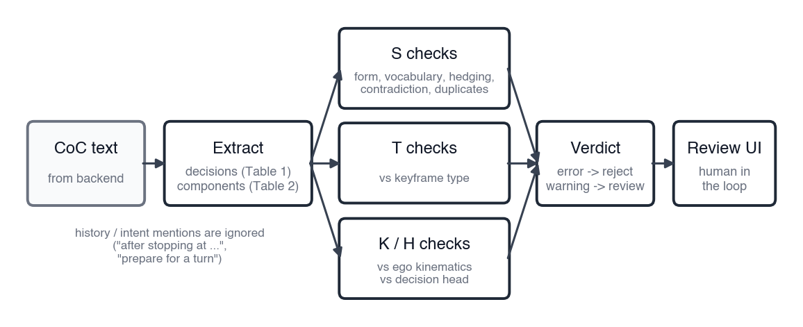
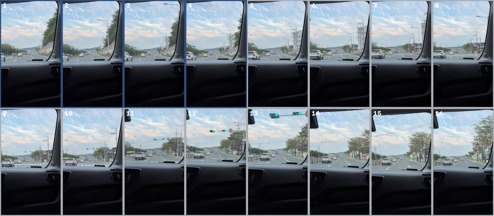
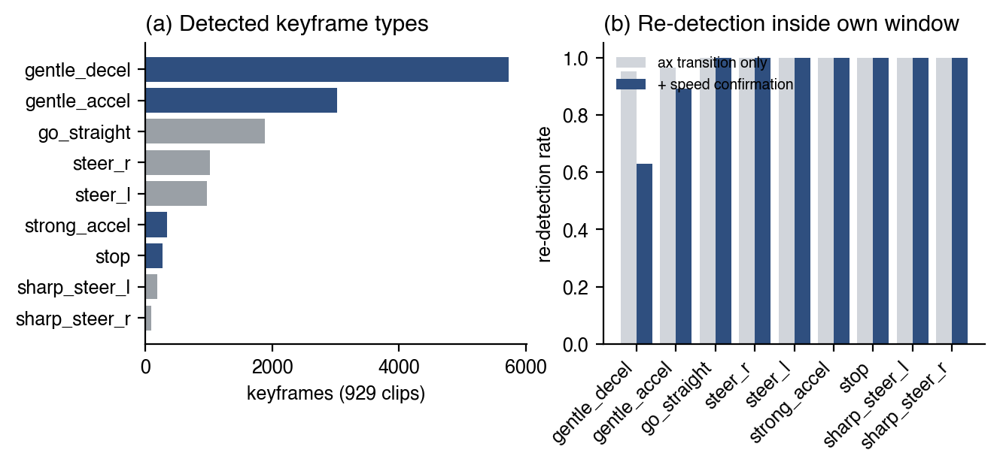
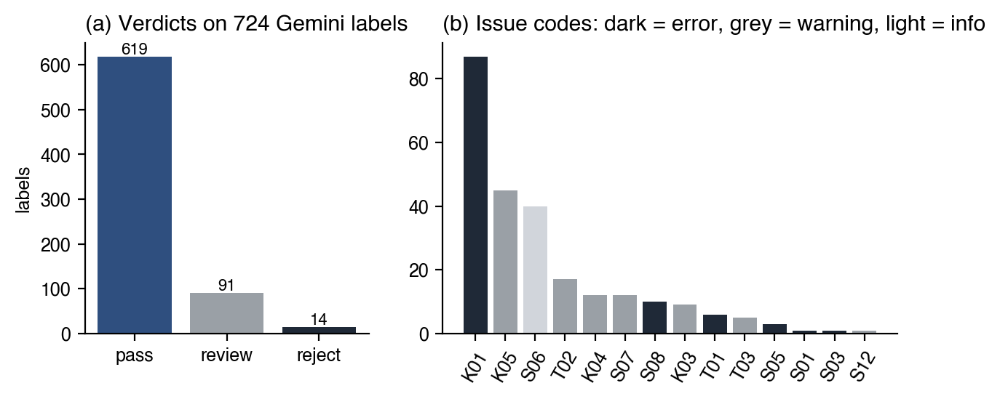
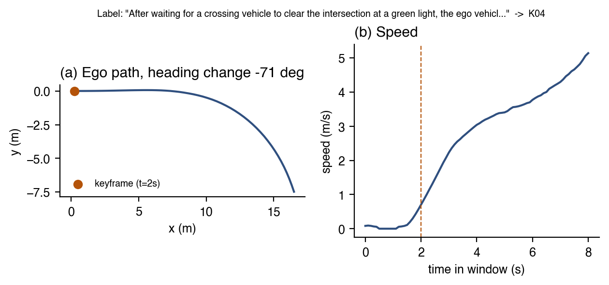
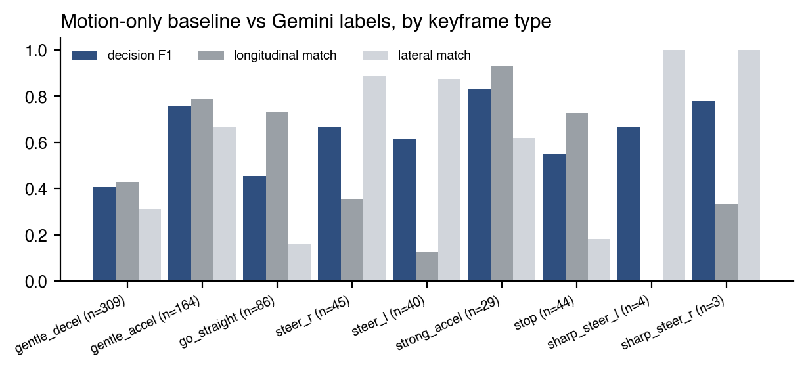
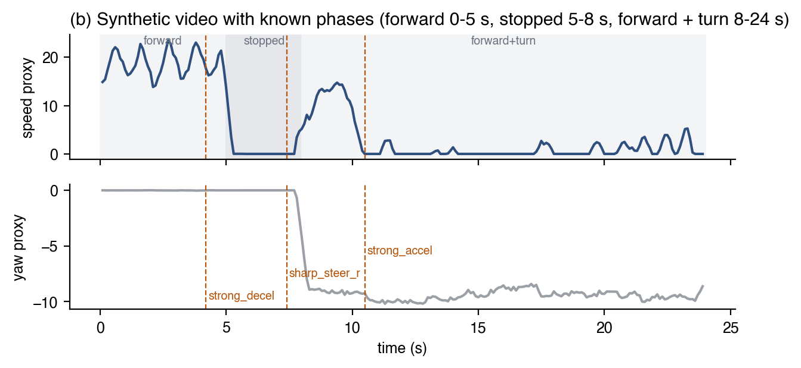
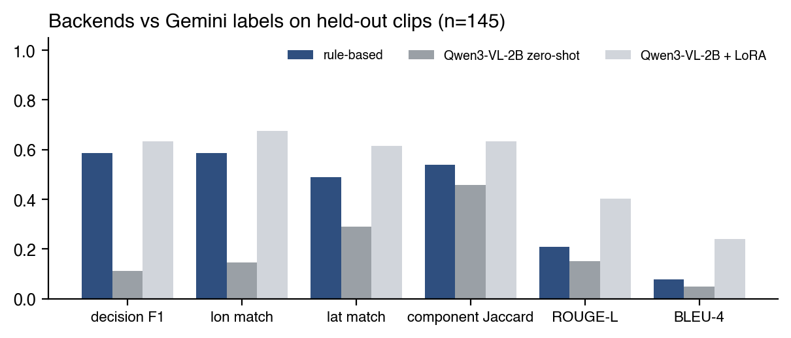

## 요약

본 작품은 사용자가 직접 촬영한 주행 영상(대시캠·스마트폰)에 Alpamayo-R1이 제안한 Chain-of-Causation(CoC) 형식의 주행 인과 설명을 자동으로 부여하는 오토라벨링 애플리케이션 “Autolabel”을 구현한 것이다. 신청서의 진행계획 중 Ⅲ(CoC 오토라벨링 파이프라인 구현: 자동 추론 엔진과 품질 필터링)과 Ⅳ(정량적 평가)를 중간 단계에서 동작하는 소프트웨어로 완성하였고, Ⅱ(VLM LoRA 파인튜닝)는 오픈 VLM Qwen3-VL-2B에 decision head 하나를 붙여 LoRA로 학습하는 파이프라인으로 구현하고, GPU(RTX 4090)에서 실제 학습과 비교 평가까지 수행하였다.

파이프라인은 (1) 영상에서 optical flow으로 ego-motion을 추정하고, (2) 종·횡방향 가속 및 곡률 전이로부터 주행 결정 시점(keyframe)을 검출하며, (3) keyframe 기준 [-2 s, +6 s] 윈도우의 16프레임을 추출하고, (4) 규칙 기반·Gemini·Qwen3-VL(+LoRA)·OpenAI 호환 서버 중 선택한 백엔드로 CoC 문장을 생성한 뒤, (5) 구조(S)·keyframe consistency(T)·kinematic consistency(K)·head consistency(H)의 27개 규칙으로 품질을 검사하고, (6) 브라우저 review UI에서 승인·수정·기각한 뒤, (7) 학습용 데이터셋(JSONL + 프레임)으로 내보낸다.

정량 평가는 NVIDIA Physical AI AV 데이터셋 282개 클립에서 Gemini로 생성한 724개 CoC 라벨을 기준으로 수행하였다. 품질 필터는 라벨당 0.31 ms 만에 85.5%를 통과, 12.6%를 review 대상, 1.9%를 기각으로 분류하였고, kinematic 검사(K04)는 차량이 70° 이상 회전했음에도 “직진”이라고 서술된 VLM 라벨 오류 12건을 실제로 검출하였다. 또한 기존 파이프라인의 가속도 기반 keyframe 중 감속 유형의 35%가 속도 감소를 동반하지 않는 잡음이며, 이 잘못된 메타 정보가 프롬프트를 통해 VLM 라벨에 그대로 전이되는 현상을 확인하고 speed confirmation 단계를 추가하였다. 파인튜닝 결과, 학습에 쓰지 않은 56개 클립 145개 윈도우에서 decision-F1이 zero-shot 0.112에서 0.632으로 올랐고 필터 기각률은 46%에서 0%로 떨어졌으며, 원인 서술 품질(ROUGE-L 0.402)은 운동 정보만 쓰는 규칙 기반 baseline(0.208)의 약 2배였다. 다만 결정 정확도 자체는 규칙 기반(0.587)과 통계적으로 구분되지 않았다(차이 +0.046, 95% 신뢰구간 [−0.035, +0.130]). 27개 단위·통합 테스트가 모두 통과하며, 합성 영상 기준 실시간 대비 약 20.7배 속도로 처리된다.


## 서론


### 1.1 제안 배경 및 필요성

자율주행 인공지능은 “무엇이 보이는가”를 인식하는 단계에서 “왜 그렇게 행동하는가”를 설명하는 단계로 진화하고 있다. NVIDIA의 Alpamayo-R1 [1]은 주행 궤적과 함께 결정의 인과 근거를 자연어로 서술하는 Chain-of-Causation(CoC) 데이터를 제안하였고, 이러한 추론 데이터로 학습한 비전-언어-행동(VLA) 모델이 롱테일 상황에서 계획 정확도를 크게 높인다는 것을 보였다. DriveLM [4] 역시 그래프 형태의 시각 질의응답으로 인식-예측-계획의 추론 사슬을 데이터화하였다. 즉 “판단의 이유”가 담긴 데이터가 설명 가능하고 안전한 자율주행의 핵심 자산이 되고 있다.

문제는 비용이다. CoC 한 문장을 만들려면 8초 남짓의 영상을 보고 결정 이전 구간에서 원인이 되는 객체를 찾고, 결정 이후 구간에서 실제로 취해진 종·횡방향 결정을 controlled vocabulary로 분류한 뒤, 둘을 인과적으로 연결해야 한다. Alpamayo-R1 논문도 이를 사람이 모두 작성하지 않고, VLM 자동 라벨링과 사람 검수를 결합한 하이브리드 파이프라인으로 구축하였다 [1]. 국내에서도 학습 데이터 자동 생성 시스템 [12], 자동 레이블링 기반 영상 학습데이터 제작 시스템 [13], 자율주행 학습 데이터 수집·전처리 환경 [14] 등 라벨링 자동화 연구가 이어지고 있으나, 대부분 객체 검출용 박스·세그먼트 라벨을 대상으로 하며 자연어 인과 설명을 다루는 사례는 드물다.

범용 VLM(Gemini, GPT, Qwen 등)에 프롬프트만 주어 CoC를 생성하는 방식에는 두 가지 한계가 있다. 첫째, 주행 도메인 지식이 부족하여 “정지선”과 “차선”을 혼동하거나 controlled vocabulary(Table 1의 15개 결정)를 벗어난 표현을 사용한다. 둘째, 생성된 문장이 실제 차량의 움직임과 모순되어도 이를 스스로 걸러내지 못한다. 본 연구에서 기존 라벨을 분석한 결과, 차량이 70° 이상 회전하는 구간을 “직진을 유지한다”고 서술하거나, 프롬프트에 주어진 잘못된 메타 정보(감속 이벤트)를 영상보다 우선시하여 실제로는 가속하는 장면을 감속으로 설명하는 사례가 실제로 존재하였다(4.3절).

한 가지 더 중요한 배경은 데이터의 출처이다. 공개 데이터셋은 촬영 지역, 차량, 센서 구성이 고정되어 있어 국내 도로나 특정 환경을 반영하기 어렵고, ego-motion·LiDAR 같은 센서 정보가 함께 제공된다는 전제 위에 설계되어 있다. 반면 연구자나 개발자가 직접 확보할 수 있는 데이터는 대개 스마트폰이나 블랙박스로 찍은 “영상만 있는” 데이터이다. 따라서 오토라벨러가 실제로 쓸모 있으려면, 센서 없이 영상 파일만 넣어도 결정 시점을 찾고 CoC를 붙여 학습용 데이터셋으로 만들어 주는 애플리케이션 형태여야 한다.

요약하면 본 작품의 필요성은 (i) CoC 라벨 구축 비용의 절감, (ii) 범용 VLM 라벨의 신뢰도 문제 해결, (iii) 센서가 없는 사용자 촬영 영상까지 라벨링 대상으로 확장하는 것에 있다.


### 1.2 연구논문/작품의 목표

신청서에 제시한 진행계획(Ⅰ 데이터 전처리, Ⅱ LoRA 파인튜닝, Ⅲ 오토라벨링 파이프라인, Ⅳ 성능 검증)에 따라 본 중간 단계의 목표를 다음과 같이 설정하였다.

- 목표 1 (파이프라인 애플리케이션): 사용자가 촬영한 영상 파일을 입력으로 받아 ego-motion 추정, keyframe 검출, 윈도우 추출, CoC 생성, 품질 필터, 검수, 데이터셋 내보내기를 명령줄과 브라우저 UI로 수행하는 소프트웨어를 구현한다.
- 목표 2 (품질 필터링): 신청서 Ⅲ의 “문법적 오류나 주행 상식에 어긋나는 논리적 모순을 자동으로 검출”하는 후처리를 규칙 기반으로 구현하되, 텍스트만이 아니라 차량의 실제 운동(정지·회전·차로 변경·속도 추세)과 대조하는 물리적 정합성 검사를 포함한다.
- 목표 3 (정량적 평가): 기준(GT) 라벨과 생성 라벨을 controlled vocabulary 수준(decision-F1)과 문장 수준(ROUGE-L, BLEU)에서 비교하는 평가 도구를 만들고, 파인튜닝 전 baseline을 확보한다.
- 목표 4 (LoRA 오토라벨러): 오픈 VLM(Qwen3-VL)에 decision head를 붙여 CoC 라벨만 잘 생성하도록 LoRA로 학습하는 파이프라인을 구현하고, zero-shot 모델·규칙 기반 baseline과 같은 지표로 비교한다.


### 1.3 작품 전체 overview

작품은 입력부터 학습까지 아홉 단계로 구성된다(그림 1). 입력은 두 갈래이다. 사용자 영상(mp4/mov, 선택적으로 GPS/IMU CSV)은 1단계 모션 추정부터 시작하고, 이미 ego-motion과 윈도우가 정의된 공개 데이터셋(physical_ai_av와 사전 작업의 Gemini 라벨)은 3단계 윈도우로 바로 들어온다. 이후 4단계 백엔드가 CoC를 생성하고 5단계 필터가 검사한 뒤 6단계 review UI를 거쳐 7단계로 내보내며, 8단계 평가 도구는 내보낸 라벨을 GT와 비교한다. 9단계 학습 모듈은 프로젝트의 윈도우·프레임·라벨로 Qwen3-VL에 LoRA와 decision head를 학습시키고, 그 어댑터는 다시 4단계 Qwen 백엔드에 장착된다. 이 순환 구조가 “한정된 CoC 데이터 → 오토라벨러 → 더 많은 데이터 → 더 나은 오토라벨러”라는 신청서의 기대효과를 구현한다.



*그림 1. Autolabel 시스템 구성도. 1–3은 영상 처리, 4–5는 라벨 생성·검사, 6–8은 검수·산출·평가, 9는 오토라벨러 파인튜닝 단계이다.*


## 관련연구


### 2.1 추론 기반 자율주행과 Chain-of-Causation

대규모 언어모델에서 중간 추론 과정을 명시적으로 생성하게 하면 복잡한 문제의 정확도가 높아진다는 Chain-of-Thought 프롬프팅 [11]은 자율주행에도 이식되었다. DriveLM [4]은 nuScenes 위에 인식→예측→계획으로 이어지는 질의응답 그래프를 구축하여 VLM이 주행 결정을 단계적으로 설명하도록 하였다. Alpamayo-R1 [1]은 한 걸음 더 나아가 “critical component → 주행 결정(driving decision)”의 인과 사슬을 8초 decision window 단위로 서술하는 CoC 데이터를 정의하고, 이를 Cosmos-Reason 기반 VLM과 확산(flow matching) 궤적 디코더로 구성된 10B 규모 VLA 모델의 지도학습·강화학습에 사용하였다. 특히 controlled vocabulary를 종방향 7종, 횡방향 8종의 controlled vocabulary(Table 1)로, critical component를 7개 범주(Table 2)로 제한한 점이 라벨의 일관성과 자동 검증 가능성을 높였으며, 본 작품의 필터와 평가 지표는 이 controlled vocabulary를 그대로 채택한다. 후속 연구인 WorkDrive [18]는 공사 구간에 특화된 CoC를, Cognitive Dual-Process Planning [19]은 추론-행동 일관성의 검증 가능성을 다루어 CoC 계열 데이터가 하나의 흐름을 형성하고 있음을 보여 준다.


### 2.2 비전-언어 모델과 효율적 파인튜닝

Qwen3-VL [2]은 2B부터 235B까지의 밀집·MoE 변형을 제공하는 개방형 VLM으로, 이미지·비디오·텍스트가 섞인 256K 토큰 문맥을 처리한다. Alpamayo-R1의 공개 구현도 Qwen3-VL 계열 백본을 사용하며, 본 작품은 같은 계열의 Instruct 모델을 오토라벨러의 기반으로 삼는다. Gemini [10]는 본 연구에서 기준 라벨 생성에 사용한 폐쇄형 멀티모달 모델이다. LoRA [3]는 사전학습 가중치를 고정한 채 저차원 행렬 쌍만 학습하여 전체 파라미터의 1% 미만으로 도메인 적응을 달성하는 기법으로, 10B 규모 VLM을 단일 GPU에서 파인튜닝할 수 있게 한다. 국내에서도 LoRA를 교육용 LLM에 적용하여 BLEU를 크게 개선한 사례 [15]와, 커리큘럼 러닝으로 LoRA 미세조정 성능을 높이는 방법론 [16]이 보고되어, 소규모 도메인 데이터로 대형 모델을 특화하는 접근이 국내외에서 검증되고 있다.


### 2.3 자동 라벨링과 weak supervision

사람이 규칙(labeling function)을 작성하고 그 출력을 확률적으로 결합하여 대량의 학습 라벨을 만드는 data programming [7]은 자동 라벨링의 이론적 토대이다. 본 작품의 규칙 기반 백엔드와 품질 필터는 이 관점에서 “kinematics 규칙”을 labeling function이자 검증 함수로 사용한다. 국내 연구로는 시뮬레이터에서 날씨·조도·차량 구성을 바꾸어 자율주행 학습 데이터를 자동 생성하는 시스템 [12], 반복적 수작업 레이블링을 자동화하는 영상 학습데이터 제작 시스템 [13], 자율주행 차량의 인공지능 학습용 데이터 수집 환경과 전처리 데이터 구축 연구 [14]가 있다. 이들은 주로 검출·분할 라벨을 다루며, 본 작품은 같은 문제의식을 자연어 인과 설명 라벨로 확장한다. 라벨링과 별개로, 사람이 최종 승인하는 human-in-the-loop 구조는 Alpamayo-R1 [1]의 데이터 구축과 동일한 원칙이다.


### 2.4 영상 기반 ego-motion 추정

센서 없이 영상만으로 차량의 움직임을 추정하는 문제는 visual odometry로 오래 연구되었다. 본 작품은 실시간성과 의존성 최소화를 위해 Farnebäck의 다항식 전개 기반 dense optical flow [5]을 사용한다. 전진 운동은 소실점을 중심으로 한 흐름장의 방사형 팽창(divergence)으로, 회전은 원거리 영역의 수평 흐름으로 나타난다는 기하학적 사실을 이용하여 속도와 Yaw proxy 신호를 얻는다. 절대 스케일은 얻을 수 없으므로 신호를 robust scale(MAD)로 정규화하고 임계값을 “표준편차 단위”로 두는 방식을 택하였다.


### 2.5 텍스트 생성 평가 지표

BLEU [8]는 n-gram 정밀도의 기하평균에 길이 페널티를 곱한 지표이고, ROUGE-L [6]은 최장 공통 부분수열 기반의 F-measure이다. 두 지표는 표현이 다양할 수 있는 CoC 문장의 “의미” 일치를 과소평가하므로, 본 작품은 controlled vocabulary로 정규화한 결정 집합의 정밀도·재현율·F1과 critical component 범주의 Jaccard를 주 지표로 하고 BLEU/ROUGE-L을 보조 지표로 사용한다.


### 2.6 데이터셋

NVIDIA Physical AI Autonomous Vehicles 데이터셋 [9]은 7개 카메라, 10 Hz ego-motion(위치·속도·가속도·곡률)이 포함된 20초 클립 모음으로, Alpamayo-R1 공개 모델의 추론 예제가 이 데이터에 맞추어 제공된다. 본 연구의 사전 작업(Gemini 라벨링 파이프라인)에서 이 데이터셋 929개 클립의 keyframe을 검출하고 282개 클립, 724개 윈도우에 Gemini로 CoC를 생성하였으며, 본 작품은 그 산출물을 평가 기준이자 파인튜닝 데이터로 사용한다.


## 제안 작품 소개


### 3.1 이론적 배경


#### 3.1.1 CoC 라벨의 구조와 decision window

CoC 한 건은 하나의 decision window에 대응한다(그림 2). keyframe(결정 시점) 이전 2초는 원인이 관찰되는 Stage I, 이후 6초는 결정이 실행되는 Stage II이며, 2 Hz로 총 16프레임을 샘플링한다. 라벨은 “The vehicle performs [결정] because [critical component] required this action to [결과]” 형식의 한 문장으로, 결정은 controlled vocabulary(표 1)에서 종·횡 각 최대 1개를 고른다. causal locality 원칙에 따라 원인은 Stage I에서만 찾아야 하며, 이 원칙은 필터 규칙 S10(미래 프레임 인용 금지)으로 검사된다.

![그림 2. decision window의 구조. keyframe 기준 [-2 s, +6 s] 구간을 2 Hz 16프레임으로 샘플링하고, 같은 구간의 10 Hz ego-motion(81개 샘플)이 kinematic 검사에 사용된다.](figures/fig_window.png)

*그림 2. decision window의 구조. keyframe 기준 [-2 s, +6 s] 구간을 2 Hz 16프레임으로 샘플링하고, 같은 구간의 10 Hz ego-motion(81개 샘플)이 kinematic 검사에 사용된다.*

**표 1. CoC 결정 controlled vocabulary(Alpamayo-R1 Table 1)**

| 범주 | 결정(정의 요약) |
| --- | --- |
| 종방향 (7) | set speed tracking(목표 속도 유지·도달) · lead obstacle following(선행차와 안전 간격 유지) · speed adaptation(곡선·방지턱 등 도로 특성에 맞춘 속도 조절) · gap-searching(횡방향 기동을 위한 속도 맞춤) · acceleration for passing(추월 가속) · yield(보행자·교차 교통에 양보) · stop for static constraints(정지선·적신호에서 감속·정지) |
| 횡방향 (8) | lane keeping & centering(차로 내 위치 유지) · merge / split(진입로·분기 전환) · out-of-lane nudge / in-lane nudge(장애물 회피 편향) · lane change(인접 차로로 이동) · pull-over / curb approach(갓길 접근) · turn(진행 방향 변경) · lateral maneuver abort(횡방향 기동 취소) |


#### 3.1.2 ego-motion으로부터의 keyframe 검출

주행 결정은 ego-motion의 상태 전이로 나타난다. 종방향은 이동평균한 종가속도 aₓ가 임계값을 넘는 순간(강가속 aₓ>3, 완가속 1.5<aₓ≤3, 완감속 −7≤aₓ<−1, 강감속 aₓ<−7 m/s²)과 0.5초 이상 속도 0.1 m/s 미만인 정지 시작을, 횡방향은 |곡률|의 전이(조향 0.02<|κ|≤0.15, 급조향 |κ|>0.15 m⁻¹, 직진 복귀 |κ|≤0.02)를 이벤트로 잡고, 결정이 전이보다 앞선다는 점을 반영해 keyframe을 전이 0.5초 전에 둔다. 여기에 세 가지 필터를 더한다. (i) 같은 유형이 3초 안에 반복되면 제거하는 cooldown, (ii) Alpamayo-R1의 데이터 구성 원칙대로 8초 윈도우당 종·횡 각 최대 1개만 남기는 cap, (iii) 윈도우가 클립 밖으로 나가는 keyframe 제거. 본 작품은 추가로 (iv) speed confirmation을 도입하였다. 가속도 신호가 감속 전이를 보고하더라도 이후 2초 안에 속도가 0.5 m/s 이상 실제로 줄지 않으면 이벤트를 버린다. 4.2절에서 보듯 기존 데이터의 감속 keyframe 중 3분의 1이 이 확인을 통과하지 못하는 잡음이었다.


#### 3.1.3 optical flow 기반 ego-motion 추정

센서가 없는 영상에서는 Farnebäck dense optical flow [5]으로 proxy 신호를 만든다. 분석 해상도 320픽셀, 10 Hz로 연속 프레임 쌍의 흐름장 F(u,v)를 구한 뒤, 팬(pan)에 의한 전역 이동을 제거하기 위해 흐름의 중앙값을 뺀다. 속도 proxy 신호는 하늘·보닛을 제외한 관심 영역에서 소실점 기준 방사 단위벡터와의 내적 평균, 즉 divergence s = mean⟨F − median(F), r̂⟩이고, Yaw proxy 신호는 원거리 띠(화면 높이 35–65%)의 수평 흐름 중앙값 y = median(Fₓ)이다. 우회전 시 장면이 왼쪽으로 흐르므로 y<0이 되어 곡률 부호 규약(좌회전 양수)과 일치한다. 두 신호를 0.5초 이동평균하고 robust scale 1.4826·MAD로 나누어 무차원화하며, 가속도는 정규화 속도의 시간 미분이다. 영상 소스에는 이 단위에 맞춘 별도 임계값(강가속 2.5, 완가속 1.0, 완감속 −1.0, 조향 1.0, 급조향 2.5)을 적용한다. 정규화된 속도와 Yaw를 적분한 dead-reckoning 경로는 회전각 검사에 쓰인다.


#### 3.1.4 품질 필터의 세 축

생성된 문장은 세 축으로 검사된다(그림 3). 먼저 controlled vocabulary의 정규식 사전으로 결정과 critical component를 추출하는데, 이때 “after stopping at the stop sign, it accelerates…”처럼 과거 맥락(history)에 등장한 결정과 “prepare for a planned right turn”처럼 의도(intent)만 언급된 회전은 결정으로 세지 않는다. 이 두 예외 처리가 없던 첫 버전은 기존 라벨의 15%를 기각했고 그 대부분이 오류였다(4.3.3절). S 검사는 길이·언어·결정 부재·결정 개수·인과 연결어·contradictory pair(예: 가속 추월 vs 정지)·hedging 표현·미래 프레임 인용·prompt leakage·critical component 부재·중복·degenerate repetition을 본다. T 검사는 keyframe 유형과 결정의 정합성으로, 감속 이벤트에 “acceleration for passing”이 붙으면 오류, 기대 집합 밖이면 경고이다. K 검사는 윈도우의 ego-motion 요약(정지 여부, 최소·최종 속도, 회전각, 횡변위, 가속도 추세)과 결정을 대조한다. 정지를 주장했는데 감속조차 없으면 오류, 회전을 주장했는데 회전각이 15° 미만이거나 직진을 주장했는데 45°를 넘으면 경고를 낸다. 파인튜닝 모델(3.3절)이 라벨을 만들 때는 네 번째 축 H가 더해져, decision head의 예측과 문장에서 추출한 결정이 다르면 경고(H01)를 낸다. 오류가 하나라도 있으면 기각, 경고만 있으면 검수, 아니면 통과이며 가중 감점으로 0–1 점수를 계산해 review 우선순위를 정한다.



*그림 3. 품질 필터의 흐름. controlled vocabulary 추출 후 구조(S), keyframe consistency(T), kinematic consistency(K) 검사를 병렬로 수행하고 판정을 review UI로 넘긴다.*


#### 3.1.5 평가 지표

생성 라벨 p와 기준 라벨 r에서 추출한 결정 집합을 각각 Dₚ, Dᵣ라 할 때 결정 정밀도 |Dₚ∩Dᵣ|/|Dₚ|, 재현율 |Dₚ∩Dᵣ|/|Dᵣ|, F1을 계산하고, 종·횡 첫 번째 결정의 일치 여부(lon/lat match), critical component 범주의 Jaccard, ROUGE-L F1 [6], 평활화된 BLEU-4 [8]를 함께 보고한다. F1의 95% 신뢰구간은 1,000회 부트스트랩으로 구한다.


### 3.2 시스템 구성


#### 3.2.1 모듈 구성

작품은 Python 패키지로 구현되었으며(파이프라인은 numpy, OpenCV, Pillow만 필수, 파인튜닝은 torch, transformers, peft) schemas(데이터 구조), motion(ego-motion 추정·로더·kinematics 요약), keyframes(결정 시점 검출), windows(윈도우·프레임 추출), vocab(controlled vocabulary·결정 추출), prompt, backends(rule_based·gemini·qwen·openai_compat), filters(품질 필터), evaluate(지표), pipeline(프로젝트 워크스페이스), ui(review UI), training(파인튜닝), cli의 모듈로 나뉜다. 백엔드·학습·UI를 포함해 약 4,800행이고 27개의 단위·통합 테스트가 있다(파일별 구성은 부록 B).


#### 3.2.2 프로젝트 워크스페이스와 데이터 흐름

사용자는 프로젝트 디렉터리 하나로 작업한다. autolabel init으로 만든 디렉터리에 add로 영상(또는 폴더)을 등록하면 clips.jsonl에 경로·해상도·fps가 기록되고, run이 motion/<clip>.json(ego-motion), windows.jsonl(윈도우와 ego 조각), frames/<clip>/kfNNN/frame_XX.jpg(16프레임)와 sheet.jpg(contact sheet), labels.jsonl(라벨·필터 결과·검수 상태)을 차례로 만든다. 모든 단계는 재개 가능하여 이미 처리된 클립은 건너뛰고, --force로 다시 만든다. 라벨은 10건마다 저장되어 API 호출 중 중단되어도 손실이 없다. export는 검수에서 기각된 것과 필터 기각을 제외하고(옵션으로 승인된 것만) 사전 작업의 Gemini 라벨과 같은 형식인 coc_results.jsonl과, 프레임 경로·타임스탬프·백엔드·필터 점수·검수 상태를 담은 samples.jsonl을 exports/<이름>/에 쓴다.


#### 3.2.3 백엔드

모든 백엔드는 Window와 프레임 목록을 받아 원문 응답을 돌려주는 하나의 인터페이스를 구현하며, FINAL_COC 한 문장은 공통 파서가 추출한다(표 2). 규칙 기반 백엔드는 픽셀을 보지 않고 kinematics 요약만으로 결정을 정하고 문장을 조립한다. 원인 객체를 알 수 없으므로 “a gentle decel event (speed 10.9 to 7.1 m/s, heading change −10 deg)”처럼 관측된 운동을 원인 자리에 적는다. 이 백엔드는 (i) GPU·API 없이 파이프라인 전체를 시험하는 대역, (ii) kinematics만으로 얻을 수 있는 성능의 하한 baseline, (iii) 필터의 K 검사가 참조하는 물리 사전이라는 세 역할을 한다.

**표 2. 라벨 생성 백엔드**

| 백엔드 | 입력 | 요구 사항 | 용도 |
| --- | --- | --- | --- |
| rule_based | ego-motion | 없음 | 오프라인 테스트, baseline, 물리 사전 |
| gemini | 16프레임 + 프롬프트 | GEMINI_API_KEY | 기준 라벨 생성(사전 작업과 동일 프롬프트) |
| qwen | 16프레임 + 프롬프트 | torch, transformers, peft, GPU | Qwen3-VL zero-shot, 또는 LoRA 어댑터 + decision head(3.3절) 장착 |
| openai | 16프레임 + 프롬프트 | vLLM/Ollama 등 호환 서버 | GPU 서버에 띄운 파인튜닝 모델 원격 사용 |


#### 3.2.4 review UI와 내보내기

review 명령은 127.0.0.1의 로컬 HTTP 서버를 띄우고 브라우저를 연다. 각 라벨 카드는 contact sheet(과거 4장과 미래 12장을 테두리 색으로 구분), keyframe 유형, 백엔드, 필터 판정과 점수, 추출된 결정·critical component, 회전각·속도 요약, 이슈 목록, 편집 가능한 문장을 보여 주며 승인·수정 저장·기각 버튼으로 상태를 바꾼다. 판정·검수 상태·검색어로 필터링할 수 있어 “review로 분류된 것만” 빠르게 훑는 워크플로를 지원한다. 수정 이력은 라벨의 meta에 남는다. 실제 주행 영상(스마트폰 촬영)에서 검출된 첫 윈도우는 녹색 신호의 교차로에 접근하는 장면이었다(그림 4).



*그림 4. 실제 주행 영상(스마트폰, 1080×1920, 30 fps)에서 검출된 decision window(t = 3.2 s)의 contact sheet. 1–4번은 결정 이전(Stage I), 5–16번은 결정 이후(Stage II) 프레임이며, 녹색 신호의 교차로에 접근하는 장면이다.*


### 3.3 오토라벨러 파인튜닝: Qwen3-VL + decision head + LoRA

신청서 Ⅱ의 파인튜닝은 자율주행 정책 모델이 아니라 “라벨을 잘 쓰는 모델”을 목표로 하므로, 오픈 VLM에 라벨링에 필요한 최소한의 구조만 더한다. 기반 모델은 Qwen3-VL Instruct(본 보고서에서는 2B, 4B/8B로 교체 가능)이고, 언어 모델의 어텐션·MLP 투영(q/k/v/o, gate/up/down)에 LoRA(r=16, α=32)를 붙이며 비전 인코더와 merger는 고정한다. 여기에 decision head 하나를 추가한다. 프롬프트의 마지막 토큰 hidden state를 LayerNorm–MLP를 거쳐 종방향 결정 8클래스(Table 1의 7종 + none)와 횡방향 결정 9클래스(8종 + none)로 분류하는 작은 네트워크이다. 헤드의 정답은 CoC 문장에서 3.1.4절의 controlled vocabulary 추출기로 자동 생성되므로 추가 라벨링이 필요 없다.

목적함수는 L = CE_text + λ·(CE_lon + CE_lat), λ = 0.5이다. CE_text는 “FINAL_COC: …” 한 문장에 대한 토큰 교차 엔트로피(프롬프트 토큰은 마스킹)이고, 두 헤드 손실은 클래스 불균형을 완화하기 위해 역빈도의 제곱근으로 가중한다. 헤드는 두 가지 역할을 한다. 학습 시에는 모델이 문장을 쓰기 전에 하나의 controlled vocabulary 결정에 “약속”하도록 만드는 보조 신호이고, 추론 시에는 문장에서 추출한 결정과 헤드 예측이 다르면 필터가 H01 경고를 내는 self-consistency 검사의 근거가 된다.

**표 3. 학습 설정(기본값)**

| 항목 | 값 |
| --- | --- |
| 기반 모델 | Qwen/Qwen3-VL-2B-Instruct (4B/8B로 교체 가능) |
| epoch | 기본 3, 실제 실행 2 (4.6절; 검증 F1 최고인 epoch 1 채택) |
| LoRA | r=16, α=32, dropout 0.05, 언어 모델 projection layer 전체 |
| decision head | LayerNorm → Linear(h, h/4) → GELU → Linear(8) / Linear(9) |
| 목적함수 | CE_text + 0.5 × (CE_lon + CE_lat), 헤드 손실 클래스 가중 |
| 입력 | 16프레임(최대 448px, 64–256 시각 토큰/장) + 2단계 프롬프트(FINAL_COC만 출력) |
| 최적화 | AdamW lr 1e-4, wd 0.01, 5% warmup 후 cosine, grad clip 1.0, 배치 1 × 누적 8, bf16 |
| 데이터 | 프로젝트의 windows/labels(또는 gt.json)/frames; 클립 단위 8:2 분할 |
| 평가 | epoch마다 val 클립에서 greedy 생성 → decision-F1, 종·횡 일치, 헤드 정확도, 필터 통과율; 최고 F1 체크포인트 저장 |

학습률 1e-4, 유효 배치 8, cosine 스케줄, 이미지 최대 변 448 px를 기본값으로 두었다(표 3). 데이터는 프로젝트 디렉터리에서 그대로 읽는다. 기존 Gemini 라벨을 학습에 쓰려면 import-d3d로 윈도우와 GT 문장을 들여온 뒤 fetch-frames가 Physical AI AV 데이터셋에서 각 윈도우의 16프레임을 Gemini가 보았던 것과 같은 4카메라 2×2 그리드로 내려받는다. 사용자가 촬영한 영상은 run으로 만든 프레임과 검수를 마친 라벨이 그대로 학습 샘플이 된다. 학습 스크립트는 zero-shot 평가(epoch 0)부터 시작해 epoch마다 검증 지표를 기록하고, 학습이 끝나면 label --backend qwen --backend-args '{"adapter_path": …}'로 어댑터와 헤드를 장착한 모델이 라벨러가 된다.


## 구현 및 결과분석


### 4.1 구현 환경과 실험 설계

구현과 E1–E5 실험은 macOS(Apple Silicon, GPU 없음), Python 3.9, numpy 2.0, OpenCV 4.x 환경에서 외부 API 없이 수행하였고, E6 파인튜닝만 RTX 4090 Linux(Python 3.11, torch 2.14, transformers 4.57, peft 0.21)에서 수행하였다. 평가 데이터는 사전 작업의 Gemini 라벨링 파이프라인이 NVIDIA Physical AI AV 데이터셋에서 만든 산출물이다. 929개 클립의 keyframe 목록(13,531개), 그중 282개 클립 724개 윈도우의 10 Hz ego-motion, 그리고 같은 윈도우에 Gemini(gemini-3.1-pro-preview, temperature 0.2, 4카메라 2×2 그리드 16프레임 입력)가 생성한 724개 CoC 문장(평균 145자)이다. 여섯 가지 실험을 설계하였다(표 4). E1–E5의 수치는 scripts/run_experiments.py 한 번으로, E6은 GPU 머신에서 scripts/run_finetune.sh로 재현된다.

**표 4. 실험 구성**

| 실험 | 질문 | 데이터 |
| --- | --- | --- |
| E1 keyframe 검출 | 검출기가 기존 keyframe을 재검출하는가, speed confirmation이 무엇을 거르는가 | 724 윈도우 ego-motion, 929 클립 keyframe |
| E2 품질 필터 | 기존 Gemini 라벨을 어떻게 판정하며 무엇을 잡아내는가 | 724 GT 라벨 + ego-motion |
| E3 규칙 기반 baseline | kinematics만으로 GT와 얼마나 일치하는가 | 724 윈도우 |
| E4 영상 입력 | 센서 없는 영상에서 결정 시점을 찾는가, 처리 속도는 | 스마트폰 주행 영상 80 s, 합성 영상 24 s |
| E5 필터 self-consistency | kinematics로 만든 라벨이 K 검사를 통과하는가 | 724 규칙 기반 라벨 |
| E6 LoRA 파인튜닝 | 파인튜닝이 zero-shot·규칙 기반 대비 라벨 품질을 올리는가 | 학습 579 / 검증 145 윈도우(클립 단위 분할), RTX 4090 |


### 4.2 E1: keyframe 검출

929개 클립에서 13,531개 keyframe을 검출하였다(그림 5(a)). 클립당 평균 14.6개(중앙값 13개)로, 완감속(5735)과 완가속(3019)이 전체의 65%를 차지하고 정지·급조향은 드물다. 이 불균형은 라벨 데이터에도 그대로 이어져 GT 724개 중 gentle_decel이 309개이다.

각 GT 윈도우의 ego-motion 8초 구간만 넣었을 때 본 작품의 검출기가 keyframe 시각(t = 2 s) ±1.5 s 안에서 같은 범주의 이벤트를 다시 찾는 비율을 측정하였다(그림 5(b)). 가속도 전이만 쓰면 97.1%(같은 유형 96.8%)로 기존 구현과 사실상 동일함을 확인하였다. speed confirmation을 켜면 전체 81.6%로 떨어지는데, 감소분은 거의 전부 gentle_decel(62.8%)과 gentle_accel(89.0%)에서 나온다. 직접 세어 보면 감속 keyframe 309개 중 109개(35.3%)는 이후 6초 동안 속도가 1 m/s도 줄지 않았고, 가속은 193개 중 10개(5.2%)만 그러하다. 즉 데이터셋의 종가속도 채널은 속도 채널과 일치하지 않는 순간적 잡음을 포함하며, 이를 그대로 쓰면 “감속하지 않은 감속 이벤트”가 대량으로 라벨링 대상이 된다. 따라서 re-detection 비율 하락은 검출 성능의 저하가 아니라 잘못된 keyframe의 제거이며, speed confirmation을 기본값으로 켜 두었다.



*그림 5. (a) 929개 클립의 keyframe 유형 분포(진한 색 종방향, 연한 색 횡방향). (b) 윈도우 내 re-detection 비율. speed confirmation은 완감속·완가속의 잡음 이벤트를 걸러낸다.*


### 4.3 E2: 품질 필터


#### 4.3.1 판정 결과

필터를 724개 GT 라벨에 적용하였다(그림 6). 통과 619개(85.5%), 검수 91개(12.6%), 기각 14개(1.9%)이며 724개를 처리하는 데 0.228초가 걸렸다. controlled vocabulary 추출 커버리지는 99.6%로, 결정을 하나도 찾지 못한 라벨은 3개뿐이다. 이슈는 정지 주장의 kinematic 검사(K01)와 감속 서술의 속도 검사(K05)가 가장 많았다(표 5).



*그림 6. (a) 724개 Gemini 라벨에 대한 필터 판정. (b) 이슈 코드 빈도. 진한 색은 오류(기각), 회색은 경고(검수), 연한 색은 정보.*

**표 5. 이슈 코드별 검출 건수(724개 GT 라벨, 상위 10개)**

| 코드 | 내용 | 건수 | 비율 |
| --- | --- | --- | --- |
| K01 | 정지 주장 vs 운동(감속 중이면 정보, 감속 없으면 오류) | 87 | 12.0% |
| K05 | 감속 서술 vs 속도 상승 | 45 | 6.2% |
| S06 | 범주당 결정 2개 이상(정보) | 40 | 5.5% |
| T02 | keyframe 범주의 결정 부재 | 17 | 2.3% |
| K04 | 직진 주장 vs 45° 이상 회전 | 12 | 1.7% |
| S07 | 인과 연결어 부재 | 12 | 1.7% |
| S08 | contradictory pair | 10 | 1.4% |
| K03 | 회전 주장 vs 15° 미만 회전각 | 9 | 1.2% |
| T01 | keyframe 유형과 모순되는 결정 | 6 | 0.8% |
| T03 | keyframe 유형에 드문 결정 | 5 | 0.7% |


#### 4.3.2 필터가 잡아낸 실제 오류

가장 의미 있는 검출은 K04(직진 주장 vs 큰 회전각) 12건이다. 그중 한 사례에서 라벨은 “교차로에서 교차 차량이 지나가길 기다린 뒤 가속하여 직진한다(proceed straight)”고 서술하지만 ego 경로는 6초 동안 71° 회전한다(그림 7). 정지 상태에서 출발하는 저속 구간이라 사람이 프레임만 보아도 놓치기 쉬운 오류이며, 텍스트만 검사하는 필터로는 원리적으로 잡을 수 없다. 12건 모두 같은 양상(정지 후 출발하며 회전)이었다.



*그림 7. K04로 기각된 라벨의 ego 경로(a)와 속도(b). 라벨은 직진을 서술하지만 차량은 좌회전한다.*

두 번째는 K05(감속 서술 vs 속도 상승) 45건이다. 예를 들어 “following a lead vehicle …, it applies gentle deceleration”이라는 라벨의 윈도우에서 속도는 5.2 m/s에서 11.5 m/s로 단조 증가한다. 원인은 4.2절의 keyframe 잡음이다. 프롬프트에 “TARGET META ACTION: [gentle_decel]”이 주어지면 VLM은 영상보다 이 메타 정보를 우선하여 존재하지 않는 감속을 서술한다. 즉 keyframe 검출 오류가 라벨 오류로 전이되며, 이것이 speed confirmation 단계와 K 검사를 함께 두어야 하는 이유이다.

T01·S08(각 6, 10건)은 “정지선에서 정지한 뒤 출발하며 속도를 회복한다”처럼 한 문장에 과거 정지와 현재 가속이 함께 담겨 모순으로 판정된 경우로, review 대상으로 남겨 두는 것이 타당하다. S05(3건)는 “applies gentle deceleration to prepare for a planned right turn”처럼 controlled vocabulary 없이 서술된 라벨이고, S03 1건은 Gemini가 INSUFFICIENT_EVIDENCE를 출력했음에도 기존 파이프라인이 저장한 것이다.


#### 4.3.3 필터의 반복 개선

필터는 GT 라벨에 대한 오탐 분석을 세 차례 반복하며 다듬었다(통과/검수/기각: v1 457/159/108 → v2 584/112/28 → v3 619/91/14). 첫 버전은 108개를 기각했는데, 그 대부분이 오탐이었다. “has stopped at the stop sign”의 과거 정지를 현재 결정으로 추출하거나, “stop sign”의 stop을 정지 동사로 세거나, “prepare for a planned right turn”의 의도를 회전 실행으로 보거나, 정지 판정을 “6초 안에 완전 정지”로만 두어 정지선을 향해 감속 중인 정상 라벨을 기각한 것이다. history/intent 예외, 정지 동사의 형태 제한, 감속 추세가 있으면 정지 주장을 허용하는 완화, 저속 구간에서 노이즈에 강한 회전각 계산(첫·끝 1 m 이동 방향 기준)을 적용하면서 기각은 14개, 검수는 91개로 줄었고 남은 기각의 대부분은 4.3.2절과 같은 실제 문제이다.

E5에서 규칙 기반 라벨 724개에 같은 필터를 적용하면 720개가 통과하고 3개 검수, 1개 기각으로, kinematics에서 만든 문장은 kinematic 검사와 일관됨을 확인하였다. 남은 몇 건은 keyframe 유형과 실제 운동이 어긋난 데이터(T 검사)이다.


### 4.4 E3: 규칙 기반 baseline

픽셀을 전혀 보지 않는 규칙 기반 백엔드의 라벨을 Gemini 라벨과 비교하였다(그림 8). decision-F1 0.548(정밀도 0.519, 재현율 0.617), 종방향 첫 결정 일치 56.1%, 횡방향 45.3%, 결정이 하나라도 겹치는 비율 75.4%이다. 문장 지표는 ROUGE-L 0.212, BLEU-4 0.077로 낮은데, critical component를 서술할 수 없는 baseline이 GT와 표현을 공유할 수 없으므로 당연한 결과이며 이 지표의 의미가 decision-F1보다 약함을 보여 준다.



*그림 8. keyframe 유형별 규칙 기반 baseline과 Gemini 라벨의 일치도.*

유형별로 보면 횡방향 이벤트(steer_l/r, sharp_steer)에서 횡방향 일치가 0.88–1.0으로 높다(그림 8). 회전은 경로에서 직접 관측되기 때문이다. 반대로 gentle_decel의 decision-F1이 0.41로 가장 낮은데, 이 유형의 GT 종방향 결정이 stop(110), lead following(91), speed adaptation(67), yield(35)로 넓게 퍼져 있고, 이 넷을 가르는 것은 “왜 감속했는가”라는 시각 정보이기 때문이다. 즉 kinematics가 결정의 절반가량을 설명하고 나머지는 시각적 원인 이해가 필요하며, 이 간극이 VLM(과 LoRA 파인튜닝)이 기여해야 할 부분이다. baseline의 처리 시간은 라벨당 0.85 ms이다.


### 4.5 E4: 사용자 영상 입력

센서가 없는 영상에 대한 검증은 두 가지로 하였다. 첫째, 스마트폰으로 차 안에서 촬영한 실제 주행 영상(1080×1920, 30 fps, 79.8초)을 등록·실행하여 모션 추정(17.1초, 실시간 대비 4.7배)부터 keyframe 검출, 프레임 추출, 규칙 기반 라벨, 필터, 내보내기까지 전체가 동작함을 확인하였다. 20개 윈도우가 검출되어 17개가 필터를 통과했다(첫 윈도우는 그림 4). 다만 이 영상은 거치대 없이 손으로 들고 찍은 것이어서 촬영자의 손 움직임이 Yaw proxy 신호를 지배하며, 그 결과 검출된 이벤트의 다수가 차량이 아닌 카메라의 회전(sharp_steer)이고 회전각 추정도 신뢰할 수 없다. 영상 기반 모션 추정은 카메라가 차체에 고정되어 있다는 가정 위에 있으므로, 대시캠이나 거치대로 고정한 영상이 필요하다.

둘째, 정답을 아는 합성 영상으로 검출 정확성을 확인하였다. 원근 투영된 텍스처 평면 위를 카메라가 6 m/s로 전진(0–5초), 정지(5–8초), 전진하며 0.35 rad/s 우회전(8–24초)하도록 렌더링한 24초 영상(240×160, 20 fps)에서, 검출기는 4.2 s strong_decel, 7.4 s sharp_steer_r, 10.5 s strong_accel을 찾았다(그림 9). 정지 시작(5.0 s)과 회전 시작(8.0 s)이 각각 0.5초 선행 규칙에 맞게 검출되었고, 회전 방향(우회전)도 Yaw 부호로 올바르게 구분되었다. 처리 시간은 모션 추정 1.16초(실시간 대비 20.7배), keyframe·프레임 추출 0.07초였으며 3개 윈도우 중 2개가 필터를 통과해 내보내졌다. 한편 회전이 시작되면 속도 proxy 신호가 크게 감소하는 현상이 보이는데, 회전 중에는 수평 흐름이 지배적이 되어 divergence 추정이 불안정해지기 때문이다. 이로 인해 회전 구간에서 거짓 가속·감속 이벤트가 생길 수 있어, 특징점 기반 visual odometry로 대체하거나 회전 중 종방향 임계값을 높이는 개선이 필요하다.



*그림 9. 합성 주행 영상의 speed·Yaw proxy 신호. 회색 구간은 전진, 붉은 구간은 정지이며 점선이 검출된 keyframe이다.*


### 4.6 E6: Qwen3-VL-2B LoRA 파인튜닝


#### 4.6.1 설정

3.3절의 파이프라인을 RTX 4090(24 GB) 한 장에서 실행하였다. 데이터는 724개 윈도우를 클립 단위로 나눈 학습 579개(226 클립)와 검증 145개(56 클립)이며, 프레임은 fetch-frames로 Physical AI AV 데이터셋에서 Gemini가 본 것과 같은 4카메라 2×2 그리드로 내려받았다(8프로세스 병렬 약 40분). 기반 모델 Qwen3-VL-2B-Instruct는 고정하고 언어 모델 projection layer LoRA(r=16, α=32)와 decision head만 학습하여 학습 파라미터는 18,494,481개(전체의 1% 미만)이다. 2 epoch, 유효 배치 8, 학습률 1e-4, 이미지 최대 변 448 px로 epoch당 6분 50초, GPU 메모리 16.7 GB가 들었다. 검증 50개의 decision-F1로 최고 체크포인트를 고르고, 최종 평가는 검증 145개 전체에서 규칙 기반·zero-shot·파인튜닝 모델을 같은 지표로 비교하였다. zero-shot 모델은 2단계 프롬프트로 THOUGHT_PROCESS까지 쓰게 하고 생성 길이를 640 토큰으로 늘려 FINAL_COC에 도달하도록 했다. 파이프라인 자체는 이 맥에서 소형 무작위 모델로 학습·저장·재로드·추론·필터 연동이 끝까지 도는지 pytest로 먼저 확인하였다.


#### 4.6.2 학습 경과

epoch마다 검증 50개로 지표를 기록하였다(표 6). 학습 전(epoch 0) 모델은 decision-F1 0.110, 필터 통과 38%로 controlled vocabulary와 출력 형식을 거의 따르지 못했으나 1 epoch 뒤 F1 0.573, 필터 통과 100%가 되었다. 2 epoch에서는 텍스트 손실이 계속 줄었음에도 검증 F1이 0.498로 떨어지고 헤드 손실이 다시 오르는 과적합 징후가 나타나 epoch 1 체크포인트를 채택하였다.

**표 6. epoch별 검증 지표(검증 50개, 학습 스크립트 내부 평가)**

| epoch | decision-F1 | 종방향 일치 | 횡방향 일치 | ROUGE-L | BLEU-4 | 헤드 종 | 헤드 횡 | 필터 통과 |
| --- | --- | --- | --- | --- | --- | --- | --- | --- |
| 0 | 0.110 | 0.12 | 0.20 | 0.271 | 0.087 | 0.00 | 0.36 | 38% |
| 1 (best) | 0.573 | 0.62 | 0.56 | 0.391 | 0.235 | 0.34 | 0.36 | 100% |
| 2 | 0.498 | 0.56 | 0.46 | 0.359 | 0.207 | 0.34 | 0.20 | 80% |


#### 4.6.3 검증 결과

학습에 쓰지 않은 56개 클립의 145개 윈도우에서 세 백엔드를 최종 비교하였다(표 7, 그림 10). 파인튜닝 모델은 decision-F1 0.632(정밀도 0.671, 재현율 0.623)로 zero-shot(0.112)을 크게 넘고 규칙 기반(0.587)도 앞섰다. 종·횡 첫 결정 일치는 68%·61%로 규칙 기반(59%·49%)보다 높고, component Jaccard 0.634, ROUGE-L 0.402, BLEU-4 0.239는 픽셀을 보지 못하는 규칙 기반(0.539, 0.208, 0.077)의 약 1.2배, 2배, 3배이다. 품질 필터는 zero-shot 라벨의 46%를 기각했지만 파인튜닝 라벨은 전부 통과시켰다. 규칙 기반과의 decision-F1 차이 +0.046는 클립 단위 부트스트랩 95% 신뢰구간이 [−0.035, +0.130](차이 ≤ 0일 확률 0.158)로 통계적으로 유의하지는 않다.

**표 7. 백엔드별 검증 성능(검증 145개 윈도우, GT = Gemini 라벨)**

| 백엔드 | decision-F1 | 정밀도 | 재현율 | 종 일치 | 횡 일치 | component Jaccard | ROUGE-L | BLEU-4 | 필터 통과 | 필터 기각 |
| --- | --- | --- | --- | --- | --- | --- | --- | --- | --- | --- |
| 규칙 기반(운동만) | 0.587 | 0.555 | 0.662 | 0.586 | 0.490 | 0.539 | 0.208 | 0.077 | 100% | 0% |
| Qwen3-VL-2B zero-shot | 0.112 | 0.112 | 0.120 | 0.145 | 0.290 | 0.459 | 0.150 | 0.048 | 19% | 46% |
| Qwen3-VL-2B + LoRA | 0.632 | 0.671 | 0.623 | 0.676 | 0.614 | 0.634 | 0.402 | 0.239 | 100% | 0% |



*그림 10. 검증 클립에서 규칙 기반, zero-shot, LoRA 파인튜닝 모델의 비교.*

유형별 decision-F1을 보면 파인튜닝 모델은 횡방향 이벤트(steer_r 0.82 vs 0.72, steer_l 1.00 vs 0.67), 정지(0.77 vs 0.64), 직진(0.69 vs 0.40)에서 규칙 기반보다 크게 앞서는 반면, 검증에서 가장 많은 완만한 감속(gentle_decel, 60개)에서는 0.48로 규칙 기반(0.54)에 뒤진다. 4.4절에서 본 대로 이 유형의 결정은 선행차 추종·속도 조절·정지 준비·양보로 갈리며, 그 구분은 시각적 원인 이해에 달려 있다. 표본이 10개 미만인 유형은 참고만 한다.


#### 4.6.4 정성 예시와 분석

검증 예시를 보면 정답·오답의 성격이 드러난다. steer_r 윈도우에서 GT가 “교차로 녹색 신호와 우회전 경로 의도 때문에 계획된 회전을 실행한다”일 때 파인튜닝 모델은 “The vehicle executes a turn to the right because the traffic light is green and the routing intent is to turn right”로 결정과 원인을 모두 맞혔다. gentle_accel 윈도우에서는 GT의 “선행차가 녹색 신호에 출발하여 선행차 추종을 위해 완만히 가속”을 “accelerates to track the lead vehicle and maintain lane centering”으로 축약해 결정은 맞고 원인 서술이 짧아졌다. 반면 go_straight 윈도우에서 GT가 선행차 추종과 차로 유지를 말할 때 모델은 “set speed tracking … because the road is clear”라고 하여 선행차를 놓쳤다. zero-shot 모델의 전형적 실패는 THOUGHT_PROCESS를 길게 쓰다 FINAL_COC 형식을 지키지 못하거나 같은 문장을 반복하는 것이며, 이것이 필터의 S 계열 오류로 기각된 46%의 대부분이다.

- 파인튜닝 효과는 명확하다. 2B zero-shot은 controlled vocabulary와 출력 형식을 따르지 못하지만(F1 0.11), LoRA 1 epoch만으로 F1 0.63, 필터 통과 100%에 도달했다. 신청서가 말한 “범용 VLM의 낮은 도메인 이해”는 형식·어휘 수준에서 실재하며 소량 데이터로 교정된다.
- 결정 정확도는 규칙 기반과 비슷하고 설명력은 뚜렷하게 우수하다. keyframe이 ego-motion 전이로 검출되고 모델도 같은 운동 정보를 프롬프트로 받으므로 결정의 상당 부분은 운동 정보로 정해지지만, 원인(신호등·선행차·보행자)은 픽셀을 본 모델만 서술할 수 있다(component Jaccard 0.63, 문장 유사도 2배). 오토라벨러의 목적이 “왜”를 쓰는 것이므로 이 차이가 본질적이다.
- decision head는 학습이 부족하고 과적합이 빠르다. 헤드 단독 정확도(종 26%, 횡 37%)가 문장의 결정 일치보다 훨씬 낮아 H01 교차검증에 아직 쓰기 어렵고, 579 샘플에서 2 epoch부터 검증 성능이 떨어졌다. 학습률 5e-5, 검증 전체로 체크포인트 선택, 헤드 가중치 1.0 및 헤드 없는 ablation이 다음 단계이다.


### 4.7 종합 분석과 한계

- 달성 1: 신청서 Ⅲ의 자동 추론 엔진(4종 백엔드 인터페이스)과 품질 필터링(27개 규칙), Ⅳ의 정량 평가 도구를 동작하는 애플리케이션으로 구현하였고, 27개 테스트와 재현 스크립트로 검증하였다.
- 달성 2: Qwen3-VL-2B LoRA 파인튜닝으로 zero-shot 대비 decision-F1 +0.52, 필터 기각률 46% → 0%, 규칙 기반 대비 ROUGE-L 약 2배·component Jaccard 0.54 → 0.63를 얻었다.
- 발견 1: 기존 CoC 데이터의 감속 keyframe 35%가 속도 변화 없는 잡음이며, 이 메타 정보가 프롬프트를 통해 VLM 라벨의 오류로 전이된다. speed confirmation과 K 검사가 이를 차단한다.
- 발견 2: 텍스트만 보는 검사로는 잡을 수 없는 “회전 중 직진” 유형의 라벨 오류가 GT의 1.7%에 존재하며, kinematic 대조가 이를 검출한다.
- 발견 3: kinematics만으로 결정의 절반 남짓을 맞힐 수 있으나 감속의 원인(정지선·선행차·곡선·양보)은 구분할 수 없고, 파인튜닝 모델의 이득도 결정 정확도보다 원인 서술에서 크다. 시각적 원인 이해가 다음 단계의 목표 영역이다.
- 한계 1: 기준 라벨이 사람이 아니라 Gemini의 출력이므로 모든 수치는 “Gemini 라벨 재현도”이며, 검증 집합이 145개(56 클립)로 작아 규칙 기반과의 차이는 신뢰구간 안에 있다. 체크포인트 선택과 최종 평가에 같은 검증 집합을 써 약간의 낙관 편향이 있을 수 있다.
- 한계 2: decision head의 단독 정확도(종 26%, 횡 37%)가 문장 내 결정 일치(68%)보다 크게 낮아 H01 교차검증은 아직 신뢰하기 어렵고, 579 샘플에서 2 epoch부터 과적합이 나타났다.
- 한계 3: 실제 주행 영상은 손으로 든 스마트폰으로 촬영되어 카메라 흔들림이 Yaw 신호를 오염시켰고, 고정 카메라 영상에 대한 검증은 남아 있다. optical flow proxy 신호는 정지·출발·회전 시작 검출에는 충분하지만 회전 중 속도 추정이 불안정하다.
- 한계 4: 필터는 영어 controlled vocabulary에 특화되어 있어 다른 언어나 자유 서술에는 정규식 사전을 확장해야 한다.


## 결론 및 소감

본 중간보고서는 사용자가 직접 촬영한 주행 영상에 CoC 인과 설명을 자동으로 붙이는 오토라벨링 애플리케이션 Autolabel의 설계·구현·검증 결과를 정리하였다. 영상만으로 결정 시점을 찾는 모션 추정기, controlled vocabulary에 기반한 결정·원인 추출기, 텍스트와 실제 운동을 대조하는 품질 필터, review UI, 학습 데이터 내보내기, 정량 평가 도구를 하나의 파이프라인으로 완성하였고, 기존 데이터를 재분석하여 keyframe 잡음과 VLM 라벨 오류라는 두 가지 실질적인 데이터 품질 문제를 찾아 대응하였다. Qwen3-VL-2B를 LoRA와 decision head로 파인튜닝하여 zero-shot으로는 형식조차 지키지 못하던 모델(decision-F1 0.11, 필터 기각 46%)을 1 epoch 만에 decision-F1 0.63, 필터 통과 100%의 라벨러로 만들었고, 원인 서술 품질은 운동 정보만 쓰는 baseline의 두 배에 이르렀다. 남은 기간에는 (1) 학습률·epoch·헤드 가중치를 조정하고 Qwen3-VL-8B(QLoRA)로 확장해 완만한 감속처럼 시각적 원인 구분이 필요한 유형의 정확도를 높이며, (2) 사람이 검수한 별도 test 집합으로 “모델 대 사람” 정확도를 측정하고, (3) 거치대에 고정한 대시캠 영상을 촬영해 센서 없는 입력에 대한 검증을 완료하며, (4) 손 흔들림에 강건한 특징점 기반 모션 추정으로 회전 중 속도·Yaw 추정을 보강할 계획이다.

소감으로, 이번 단계에서 가장 크게 배운 것은 “라벨을 만드는 것”보다 “라벨을 의심하는 것”이 어렵고 중요하다는 점이다. 처음에는 VLM이 만든 문장을 정답으로 두고 필터를 만들었지만, 필터의 첫 버전이 108개를 기각했을 때 그 대부분은 필터의 오탐이었고 소수는 진짜 라벨 오류였다. 둘을 가르기 위해 문장을 하나씩 읽고 차량의 경로를 그려 보는 과정에서, 규칙을 세 번 갈아엎으며 과거 맥락과 의도 표현이라는 언어적 미묘함을 코드로 옮기는 경험을 했다. 또한 가속도 신호가 속도와 모순되는 데이터셋의 특성을 발견했을 때, 상류(keyframe) 오류가 하류(라벨)로 조용히 전파된다는 사실이 데이터 파이프라인 전체를 하나의 시스템으로 보아야 하는 이유를 실감하게 했다. 외부 API와 GPU 없이도 재현 가능한 실험을 먼저 갖추어 두니, GPU 머신에서 파인튜닝을 돌린 뒤 규칙 기반·zero-shot·파인튜닝 모델을 같은 잣대로 바로 비교할 수 있었다. zero-shot 모델이 긴 추론을 쓰다 형식을 놓치던 것이 1 epoch 학습으로 정리되는 것을 보며, 작은 도메인 데이터라도 “형식과 어휘”를 가르치는 효과가 얼마나 큰지, 반대로 “결정의 원인을 보는 눈”은 데이터와 모델 크기가 더 필요하다는 점을 체감하였다.


## 참고문헌

[1] Y. Wang, W. Luo, J. Bai, et al., "Alpamayo-R1: Bridging Reasoning and Action Prediction for Generalizable Autonomous Driving in the Long Tail," arXiv:2511.00088, 2025.

[2] S. Bai, Y. Cai, R. Chen, et al., "Qwen3-VL Technical Report," arXiv:2511.21631, 2025.

[3] E. J. Hu, Y. Shen, P. Wallis, Z. Allen-Zhu, Y. Li, S. Wang, L. Wang, and W. Chen, "LoRA: Low-Rank Adaptation of Large Language Models," in Proc. ICLR, 2022.

[4] C. Sima, K. Renz, K. Chitta, L. Chen, H. Zhang, C. Xie, J. Beißwenger, P. Luo, A. Geiger, and H. Li, "DriveLM: Driving with Graph Visual Question Answering," in Proc. ECCV, 2024.

[5] G. Farnebäck, "Two-Frame Motion Estimation Based on Polynomial Expansion," in Proc. Scandinavian Conf. on Image Analysis (SCIA), LNCS 2749, pp. 363-370, 2003.

[6] C.-Y. Lin, "ROUGE: A Package for Automatic Evaluation of Summaries," in Proc. ACL Workshop on Text Summarization Branches Out, pp. 74-81, 2004.

[7] A. Ratner, S. H. Bach, H. Ehrenberg, J. Fries, S. Wu, and C. Ré, "Snorkel: Rapid Training Data Creation with Weak Supervision," Proc. VLDB Endowment, vol. 11, no. 3, pp. 269-282, 2017.

[8] K. Papineni, S. Roukos, T. Ward, and W.-J. Zhu, "BLEU: a Method for Automatic Evaluation of Machine Translation," in Proc. ACL, pp. 311-318, 2002.

[9] NVIDIA, "Physical AI Autonomous Vehicles Dataset," Hugging Face, https://huggingface.co/datasets/nvidia/PhysicalAI-Autonomous-Vehicles, 2025.

[10] Gemini Team, Google, "Gemini: A Family of Highly Capable Multimodal Models," arXiv:2312.11805, 2023.

[11] J. Wei, X. Wang, D. Schuurmans, M. Bosma, B. Ichter, F. Xia, E. Chi, Q. Le, and D. Zhou, "Chain-of-Thought Prompting Elicits Reasoning in Large Language Models," in Proc. NeurIPS, 2022.

[12] 윤승제, 정지원, 홍준, 임경일, 김재환, 김형주, "자율주행 차량의 학습 데이터 자동 생성 시스템 개발," 한국ITS학회 논문지, 제19권, 제5호, pp. 162-177, 2020.

[13] 이용, 장래영, 박민우, 이건우, 최명석, "자동-레이블링 기반 영상 학습데이터 제작 시스템," 한국콘텐츠학회논문지, 제21권, 제6호, pp. 701-715, 2021.

[14] 사의환, 최경수, 조성현, 김성진, "자율주행 차량의 인공지능 학습용 데이터 수집 환경 및 전처리 데이터 구축에 관한 연구," 제어로봇시스템학회 국내학술대회 논문집, pp. 536-537, 2022.

[15] 이태오, 김택국, "LoRA 기반 파인튜닝을 활용한 초등 경제 교육용 대규모 언어모델 개발 및 성능 평가," 사물인터넷융복합논문지, 제12권, 제1호, pp. 17-23, 2026.

[16] 김대건, 김남규, "LoRA 미세조정 성능 향상을 위한 커리큘럼 러닝 기반 방법론," 한국컴퓨터정보학회논문지, 제29권, 제3호, pp. 43-54, 2024.

[17] NVlabs, "alpamayo: NVIDIA Alpamayo 1 Nano open 10B reasoning VLA model," GitHub, https://github.com/NVlabs/alpamayo, 2025.

[18] T. Jiang, W. Zhang, S. Yang, et al., "WorkDrive: Roadwork Chain of Causation for Autonomous Driving," arXiv:2607.14727, 2026.

[19] Z. Yang, H. Li, Y. Yan, et al., "Cognitive Dual-Process Planning for Autonomous Driving with Structured Scene Knowledge and Verifiable Reasoning-Action Consistency," arXiv:2607.19194, 2026.


## 부록 A. 사용법

설치와 실행은 다음과 같다. 규칙 기반 백엔드는 추가 의존성이 없고, Gemini는 API 키, Qwen은 GPU와 torch/transformers/peft가 필요하다.

```bash
(내 영상 라벨링)


python -m autolabel init  myproj --uniform 8        # 이벤트가 없으면 8초마다 윈도우
python -m autolabel add   myproj ~/Videos/drive1.mp4   # 폴더를 주면 안의 모든 영상 등록
python -m autolabel run   myproj --backend rule_based  # 모션 추정 → keyframe → 프레임 → 라벨 → 필터
python -m autolabel review myproj                      # http://127.0.0.1:8765 검수 UI
python -m autolabel export myproj --name v1            # myproj/exports/v1/


VLM 백엔드:


export GEMINI_API_KEY=...
python -m autolabel label myproj --backend gemini --force
python -m autolabel label myproj --backend qwen                                             # zero-shot Qwen3-VL
python -m autolabel label myproj --backend qwen --backend-args '{"adapter_path": "runs/qwen2b/best"}'   # fine-tuned (LoRA + head)
python -m autolabel label myproj --backend openai --backend-args '{"base_url": "http://localhost:8000/v1", "model": "Qwen/Qwen3-VL-8B-Instruct"}'


GPS/IMU 로그가 있으면 `add ... --csv log.csv` (time, speed, ax, yaw_rate/curvature 열 인식).
```


## 부록 B. 원천코드

원천코드 전체는 아래 GitHub 저장소에 있으며, 저장소의 파일 구성과 행 수는 본문에서 설명한 모듈과 일대일로 대응한다(표 8).

https://github.com/churrosboy/autolabel

**표 8. 저장소 구성**

| 파일 | 역할 | 행 수 |
| --- | --- | --- |
| autolabel/schemas.py | 데이터 구조 | 237 |
| autolabel/motion.py | ego-motion 추정·로더·kinematics 요약 | 366 |
| autolabel/keyframes.py | keyframe 검출 | 188 |
| autolabel/windows.py | 윈도우·프레임 추출 | 138 |
| autolabel/vocab.py | controlled vocabulary·결정 추출 | 352 |
| autolabel/prompt.py | 프롬프트·파싱 | 87 |
| autolabel/backends/base.py | 백엔드 인터페이스 | 44 |
| autolabel/backends/rule_based.py | 규칙 기반 백엔드 | 103 |
| autolabel/backends/gemini.py | Gemini 백엔드 | 84 |
| autolabel/backends/qwen.py | Qwen3-VL(+LoRA·헤드) 백엔드 | 104 |
| autolabel/backends/openai_compat.py | OpenAI 호환 서버 백엔드 | 73 |
| autolabel/filters.py | 품질 필터 | 211 |
| autolabel/evaluate.py | 평가 지표 | 139 |
| autolabel/sources.py | 데이터셋 import | 98 |
| autolabel/pipeline.py | 프로젝트 워크스페이스 | 411 |
| autolabel/cli.py | 명령줄 | 173 |
| autolabel/ui/server.py | review UI 서버 | 97 |
| autolabel/ui/index.html | review UI 화면 | 88 |
| autolabel/training/data.py | 학습 샘플·분할·헤드 라벨 | 161 |
| autolabel/training/collate.py | 배치 구성 | 92 |
| autolabel/training/model.py | Qwen3-VL + LoRA + decision head | 187 |
| autolabel/training/train.py | 학습 루프·평가 | 252 |
| autolabel/training/fetch_frames.py | physical_ai_av 프레임 다운로드 | 116 |
| scripts/run_experiments.py | E1–E5 실험 재현 | 309 |
| scripts/run_finetune.sh | E6 파인튜닝 전체 실행 | 46 |
| scripts/compare_backends.py | 백엔드 비교 | 92 |
| tests/ (7 files) | pytest 27개 | 462 |
